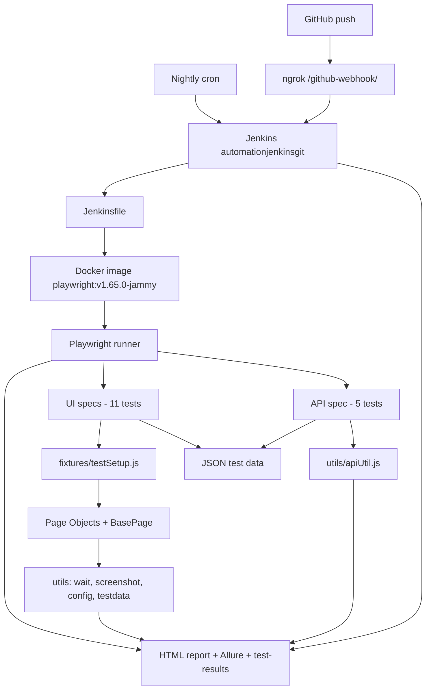

# AdactinAutomation

A complete Playwright (JavaScript) automation framework for the **Adactin Hotel App** (`https://adactinhotelapp.com/`). It covers UI automation, REST API automation, data-driven testing, hooks and utilities, screenshots, Allure reporting, and a Docker + Jenkins CI/CD pipeline.

**Repository name:** `AdactinAutomation`  
**Repository URL:** `https://github.com/mohitkumar081/AdactinAutomation.git`  
**Description:** `Playwright JS framework for Adactin Hotel App with POM, JSON data-driven tests, hooks/fixtures, Allure reporting, screenshots and REST API automation — 16 tests (11 UI + 5 API).`

**Application under test:** <https://adactinhotelapp.com/>  
**API under test:** <https://api-testing-postman.vercel.app/>

---

## Table of contents

1. [What this project does](#what-this-project-does)
2. [Framework features](#framework-features)
3. [Project structure](#project-structure)
4. [Prerequisites](#prerequisites)
5. [Local setup](#local-setup)
6. [Running tests](#running-tests)
7. [Test data](#test-data)
8. [API automation](#api-automation)
9. [Test coverage](#test-coverage)
10. [Architecture](#architecture)
11. [Hooks and utilities](#hooks-and-utilities)
12. [Reports, screenshots and logs](#reports-screenshots-and-logs)
13. [Docker](#docker)
14. [Jenkins CI/CD](#jenkins-cicd)
15. [Publishing to GitHub](#publishing-to-github)
16. [Troubleshooting](#troubleshooting)

---

## What this project does

- Automates the Adactin booking flow: login → search hotel → select hotel → book hotel → confirmation → booked itinerary.
- Runs positive scenarios (TC-02 to TC-06), negative scenarios (TC-07 to TC-11), and one full end-to-end flow (TC-01).
- Tests REST APIs with Playwright's built-in `request` fixture: GET, POST, PUT and DELETE.
- Validates status codes, response body, JSON schema, `content-type` header and response time.
- Reads credentials, endpoints, payloads and expected results from JSON files.
- Generates Allure and Playwright HTML reports with screenshots, videos, traces and execution logs.
- Runs the same suite inside a Docker container through a declarative Jenkins pipeline.

There is deliberately **no separate `login.spec.js`**. Login is already covered by TC-02, so adding another file would only duplicate the report entry.

---

## Framework features

| Feature | Implementation |
| --- | --- |
| Page Object Model | One class per page under `pages/`, with `BasePage.js` for shared actions |
| Data-driven testing | `testdata/loginData.json`, `searchData.json`, `bookingData.json`, `apiData.json` |
| Fresh JSON loading | `utils/testdata.js` re-reads data and supports `DATASET_INDEX` |
| Fixtures and hooks | `fixtures/testSetup.js`: `beforeAll`, auto `pageSetup`, `afterEach`, `afterAll` |
| Reusable waits | `utils/waitutil.js`, used by `BasePage` |
| Screenshot utility | `utils/screenshotutil.js`: step, final and failure screenshots |
| Core actions | Login/logout, navigation, alerts/popups, waits, screenshots and logs in `pages/BasePage.js` |
| API validation | `utils/apiUtil.js`: status, body, schema, headers and response time |
| API automation | `tests/api.spec.js` with Playwright `request` fixture |
| Reporting | List reporter + Playwright HTML + Allure in `playwright.config.js` |
| CI/CD | `Dockerfile`, `Jenkinsfile`, and `jenkins-build.cmd` as manual reference |

---

## Project structure

```text
AdactinAutomation/
├── Dockerfile
├── Jenkinsfile
├── jenkins-build.cmd
├── playwright.config.js
├── package.json
├── package-lock.json
├── .gitignore
├── .dockerignore
├── README.md
├── ALLURE_AND_CORE_METHODS.md
├── JENKINS_SETUP.md
├── docs/
│   ├── ARCHITECTURE.md
│   └── architecture.svg
├── fixtures/
│   └── testSetup.js
├── pages/
│   ├── BasePage.js
│   ├── LoginPage.js
│   ├── SearchHotelPage.js
│   ├── SelectHotelPage.js
│   ├── BookingPage.js
│   ├── BookingConfirmationPage.js
│   └── ItineraryPage.js
├── tests/
│   ├── api.spec.js
│   ├── endToEnd.spec.js
│   ├── negativeTests.spec.js
│   └── positiveTests.spec.js
├── utils/
│   ├── apiUtil.js
│   ├── config.js
│   ├── screenshotutil.js
│   ├── testdata.js
│   └── waitutil.js
└── testdata/
    ├── apiData.json
    ├── bookingData.json
    ├── loginData.json
    └── searchData.json
```

Generated folders such as `allure-results/`, `allure-report/`, `playwright-report/`, `test-results/` and `blob-report/` are created when tests run. They are ignored by Git and are not committed.

---

## Prerequisites

- **Node.js 18+** and npm (20+ recommended)
- Git
- Internet access for `https://adactinhotelapp.com/` and `https://api-testing-postman.vercel.app/`
- Playwright Chromium browser installed once during setup
- **Docker** only if you want a containerized run
- **Jenkins** only for CI/CD, with Git, GitHub, Pipeline, HTML Publisher and Allure plugins

Check your versions:

```bash
node --version
npm --version
```

---

## Local setup

```bash
git clone https://github.com/mohitkumar081/AdactinAutomation.git
cd AdactinAutomation
npm ci
npx playwright install chromium
```

If the repository is already cloned, open that folder and start from `npm ci`.

On Linux, use `npx playwright install --with-deps chromium` to install system dependencies as well. On Windows, the plain install command is enough.

---

## Running tests

Run the full 16-test suite in Chromium:

```bash
npm test
```

Run only the API suite:

```bash
npm run test:api
```

Generate and open the Allure report:

```bash
npm run allure:generate
npm run allure:open
```

Open the Playwright HTML report:

```bash
npx playwright show-report
```

Useful scripts from `package.json`:

| Command | Purpose |
| --- | --- |
| `npm test` | Run all 16 tests in Chromium |
| `npm run test:api` | Run only the 5 API tests |
| `npm run allure:generate` | Generate `allure-report/` from `allure-results/` |
| `npm run allure:open` | Open the generated Allure report |

`playwright.config.js` also defines Firefox and WebKit projects, but the npm scripts and CI intentionally use Chromium only.

> Run one command per line. Do not add extra words between commands.

---

## Test data

### `testdata/loginData.json`

Holds the valid, invalid and empty login datasets. `utils/testdata.js` reads this file fresh at runtime and picks an entry from `validUsers[]`. Index `0` is the default working account.

```json
{
  "validUsers": [
    {
      "username": "haristester01",
      "password": "haristester01",
      "ExpectedMsg": "Welcome to Adactin Group of Hotels"
    },
    {
      "username": "RandomGuy9571",
      "password": "Random9571",
      "ExpectedMsg": "Welcome to Adactin Group of Hotels"
    }
  ],
  "invalidUser": {
    "username": "invalid_user",
    "password": "wrong_password"
  },
  "emptyUser": {
    "username": "",
    "password": ""
  }
}
```

Switch dataset without touching a spec:

```bash
DATASET_INDEX=1 npx playwright test --project=chromium
```

On Windows PowerShell:

```powershell
$env:DATASET_INDEX = "1"
npx playwright test --project=chromium
Remove-Item Env:\DATASET_INDEX
```

### Other JSON files

| File | Used for |
| --- | --- |
| `searchData.json` | Hotel search fields and expected search results |
| `bookingData.json` | Guest and card details used by booking tests |
| `apiData.json` | Base URL, endpoint paths, payloads, expected status/messages, schemas and max response time |

API payloads use a `{timestamp}` placeholder. It is resolved per request so repeated runs do not collide.

---

## API automation

There is no local mock server and no DemoQA dependency. The suite calls the public API host configured in `testdata/apiData.json`.

| Test | Method | Endpoint |
| --- | --- | --- |
| API-01 | GET | `/api/v1/users/all-users` |
| API-02 | POST | `/api/v1/users/register` |
| API-03 | POST | `/api/v1/users/login` |
| API-04 | PUT | `/api/v1/users/replace-account` |
| API-05 | DELETE | `/api/v1/users/delete-account` |

`tests/api.spec.js` uses Playwright's `request` fixture. `utils/apiUtil.js` validates:

- expected status code
- expected response message/body fields
- JSON schema defined in `apiData.json`
- `content-type` header
- response time against `maxResponseTimeMs`

The public host sometimes returns a transient `500` or an HTML body. The API tests retry a few times before failing, and CI runs them serially to avoid rate-limit noise. API results go into the same Allure and HTML reports as the UI tests.

---

## Test coverage

16 tests, split into UI and API:

| Area | Tests |
| --- | --- |
| End-to-end | 1 — TC-01 complete booking flow |
| Positive UI | 5 — TC-02 login, TC-03 search, TC-04 select/book, TC-05 confirmation, TC-06 logout |
| Negative UI | 5 — TC-07 invalid login, TC-08 missing search fields, TC-09 missing booking details, TC-10 invalid card, TC-11 unauthorised confirmation |
| API | 5 — API-01 GET, API-02 POST register, API-03 POST login, API-04 PUT replace, API-05 DELETE |

TC-01 uses fixed early dates because the shared Adactin account has a large Booked Itinerary list sorted by arrival date. A far-future booking drops out of that visible list, so the test confirms the order on the confirmation page instead.

---

## Architecture



Full component details, layer rules and design notes are in [`docs/ARCHITECTURE.md`](docs/ARCHITECTURE.md). A static version of the same diagram is in [`docs/architecture.svg`](docs/architecture.svg).

The simple rule: specs keep assertions, Page Objects keep locators, utilities keep repeated logic, JSON keeps values, Jenkins keeps the evidence.

---

## Hooks and utilities

- `fixtures/testSetup.js` has suite-level `beforeAll()` / `afterAll()` markers, an auto `pageSetup` fixture that opens the app before every test, and an `afterEach()` hook that attaches a lifecycle log plus final/failure screenshots.
- `pages/BasePage.js` provides reusable login/logout, navigation, explicit and implicit-style waits, alerts/popups, screenshots and Allure log attachments.
- `utils/waitutil.js` centralizes the wait conditions used by `BasePage`.
- `utils/screenshotutil.js` captures step and after-each screenshots. Screenshot failure is best-effort: it never turns a passing test red.
- `utils/apiUtil.js` holds API validation helpers.
- `utils/config.js` holds the application URL and shared timeouts.
- `utils/testdata.js` re-reads JSON from disk instead of relying on `require()` caching.

Browser creation and closure are handled by Playwright's built-in fixtures, so custom `globalSetup` / `globalTeardown` files are not needed here.

---

## Reports, screenshots and logs

After a run:

```bash
npm run allure:generate
npm run allure:open
npx playwright show-report
```

Reports include:

- test summary and pass/fail details
- execution time
- step screenshots and failure screenshots
- video and trace on failure
- stdout attached to Allure results
- per-test status, project and retry info attached by `afterEach()`

Locations:

| Output | Path |
| --- | --- |
| Allure JSON results | `allure-results/` |
| Allure HTML report | `allure-report/index.html` |
| Playwright HTML report | `playwright-report/index.html` |
| Screenshots, videos, traces | `test-results/` |

All of these are generated folders and ignored by Git. Jenkins copies them out of the container and archives them on every build, so the evidence stays available after the workspace is cleaned. Selected successful-run screenshots can be kept under `docs/evidence/`.

More detail is in [`ALLURE_AND_CORE_METHODS.md`](ALLURE_AND_CORE_METHODS.md).

---

## Docker

Build and run locally:

```bash
docker build --load -t playwright-tests .
docker run --rm playwright-tests
```

The image is based on the official Playwright image, installs locked dependencies with `npm ci`, installs browser dependencies, then runs:

```bash
npx playwright test --project=chromium
```

`CI=true` inside the image gives one worker and two retries, which keeps the shared demo site and public API stable.

To keep Allure results on the host:

```powershell
docker run --rm -v "${PWD}\allure-results:/app/allure-results" playwright-tests
```

If your Docker CLI uses the legacy builder, `--load` is rejected with `unknown flag: --load`. Use this instead:

```bash
docker build -t playwright-tests .
```

The legacy builder already loads the image into the local daemon. `Jenkinsfile` tries `--load` first and falls back automatically.

---

## Jenkins CI/CD

`Jenkinsfile` is a declarative pipeline. It:

1. Checks out `main` from GitHub.
2. Builds `playwright-tests:jenkins-$BUILD_NUMBER`.
3. Runs all 16 UI + API tests inside the container.
4. Copies `playwright-report`, `allure-results` and `test-results` out of the container.
5. Publishes the Playwright HTML report and the Allure report.
6. Archives reports, screenshots, videos, traces and logs.
7. Removes the container in `post { always }`.

| Item | Value |
| --- | --- |
| Job | `automationjenkinsgit` |
| Definition | Pipeline script from SCM |
| SCM | Git |
| Repository URL | `https://github.com/mohitkumar081/AdactinAutomation.git` |
| Credentials | `github-playwright` |
| Branch | `*/main` |
| Script path | `Jenkinsfile` |
| Required plugins | Git, GitHub, GitHub Integration, Pipeline, HTML Publisher, Allure |
| Global `PATH` | Docker CLI and Node.js are both available to the Jenkins service |
| Triggers | `githubPush()` and `cron('H 3 * * *')` |
| Webhook | `https://crawlers-tadpole-saffron.ngrok-free.dev/github-webhook/`, JSON, push only |

The GitHub webhook ID is `717308645`. Push deliveries have returned HTTP `200`, and Jenkins has started builds from the webhook without clicking **Build Now**. The free ngrok URL changes when the tunnel restarts; update the webhook payload URL in that case, or use a static ngrok domain.

`jenkins-build.cmd` stays in the repo only as the manual/Freestyle reference. The Pipeline job reads `Jenkinsfile` from GitHub and does not use that `.cmd`.

Full one-time setup, Allure tool configuration and troubleshooting notes are in [`JENKINS_SETUP.md`](JENKINS_SETUP.md).

---

## Publishing to GitHub

From inside the cloned project folder:

```bash
git init
git add .
git commit -m "Initial Adactin automation framework"
git branch -M main
git remote add origin https://github.com/mohitkumar081/AdactinAutomation.git
git push -u origin main
```

If the folder is already a Git repository, skip `git init`. If the remote is already set, skip `git remote add origin` and just use:

```bash
git push origin main
```

Never commit tokens, generated reports, `node_modules`, or the unrelated nested duplicate folder.

---

## Troubleshooting

| Problem | Fix |
| --- | --- |
| `Executable doesn't exist` | Run `npx playwright install chromium` |
| `ERR_NAME_NOT_RESOLVED` for Adactin | Check internet/VPN and rerun |
| API returns transient `500` or HTML | Expected on the public host; tests retry before failing |
| `unknown flag: --load` | Legacy Docker builder; use plain `docker build -t playwright-tests .` |
| `Unable to find image ... locally` | BuildKit kept the image in cache; add `--load` when supported |
| `No Allure installation found` in Jenkins | Configure the Allure tool under Manage Jenkins → Tools → Allure |
| Webhook not triggering | Check the tunnel is online and the payload URL matches the current ngrok URL; Recent Deliveries must show `200` |
| E2E booking not visible in itinerary | Known shared-account limit; TC-01 intentionally uses early dates |
| Screenshot attachment warning | Best-effort utility retries once and attaches a text note; it does not fail the test |
| `Serving HTML report...` keeps the terminal busy | Press `Ctrl+C` |
| Jenkins checkout authentication error | Use the `github-playwright` Jenkins credential; never paste a PAT into a file or chat |
