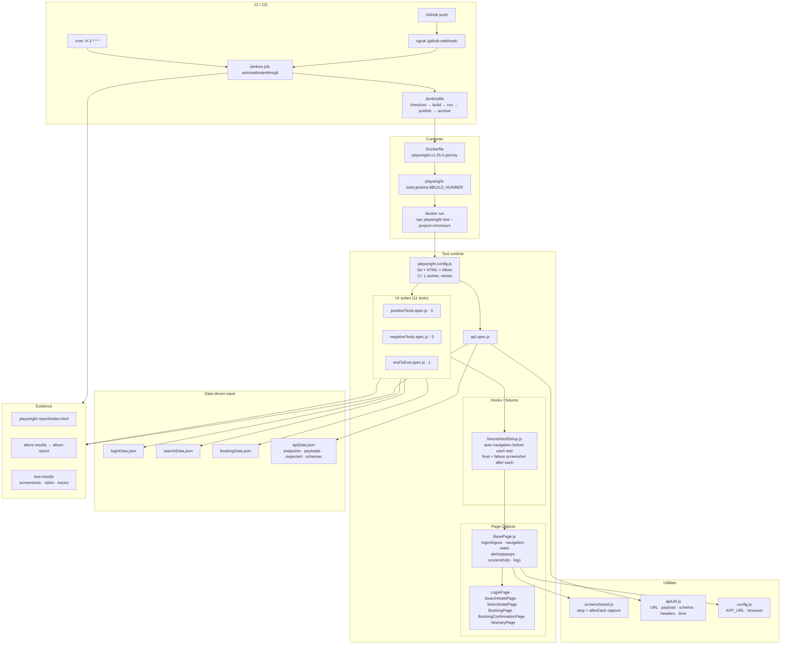

# Framework architecture

This is the map of the framework as it exists in this repository — not a wish list.
Every box below has a file behind it.

A plain-SVG copy of the same diagram is in [`architecture.svg`](architecture.svg).
GitHub renders the Mermaid block above directly, so the diagram is versioned with the code.

## How a request flows

### UI test

1. `fixtures/testSetup.js` opens `APP_URL` through `BasePage.navigate()` before the test body runs.
2. The spec creates the Page Objects it needs (`LoginPage`, `SearchHotelPage`, ...).
3. Each Page Object exposes actions only; assertions stay in the spec.
4. `BasePage` supplies the repeated work: click/fill/select, explicit waits,
   `setImplicitTimeout()`, login/logout, dialog and popup handling, screenshots and logs.
5. `afterEach` attaches a final screenshot — and a failure screenshot when the
   outcome differs from `expectedStatus`.
6. Playwright writes the HTML report, Allure JSON and `test-results` attachments.

### API test

1. `api.spec.js` asks Playwright for the `request` fixture (`APIRequestContext`).
2. Endpoint paths, payload templates, expected status, messages, content type,
   maximum response time and schemas come from `testdata/apiData.json`.
3. `utils/apiUtil.js` expands `{timestamp}`, builds the URL, validates the
   schema recursively, and asserts status/header/response time.
4. The response body is attached to the running test, so API evidence lands in
   the same Allure run as the UI tests.

## Layer rules

- **Specs** decide what is expected. They do not contain locators.
- **Page Objects** own locators and actions for one page. They do not own test data.
- **BasePage / utilities** own anything used by more than one page or suite.
- **JSON files** own input values and API expectations. Adding a dataset should not
  require editing a spec.
- **Jenkinsfile / Dockerfile** own execution and evidence export. They never touch
  application logic.

## Why it is shaped like this

The Adactin demo account is shared and the Booked Itinerary page is heavy, so CI runs
with one worker and retries. The public API sometimes answers with a transient 500,
so `send()` retries the request before asserting. Screenshot capture is best-effort:
a flaky PNG must never turn a passing test into a red build. These are deliberate
trade-offs, not shortcuts.
